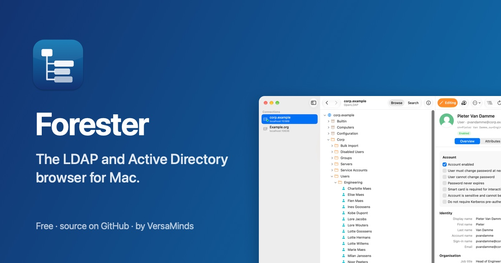
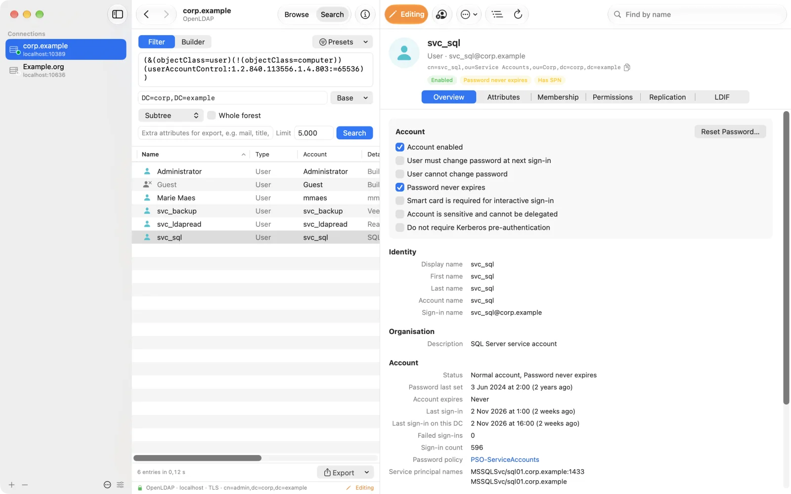
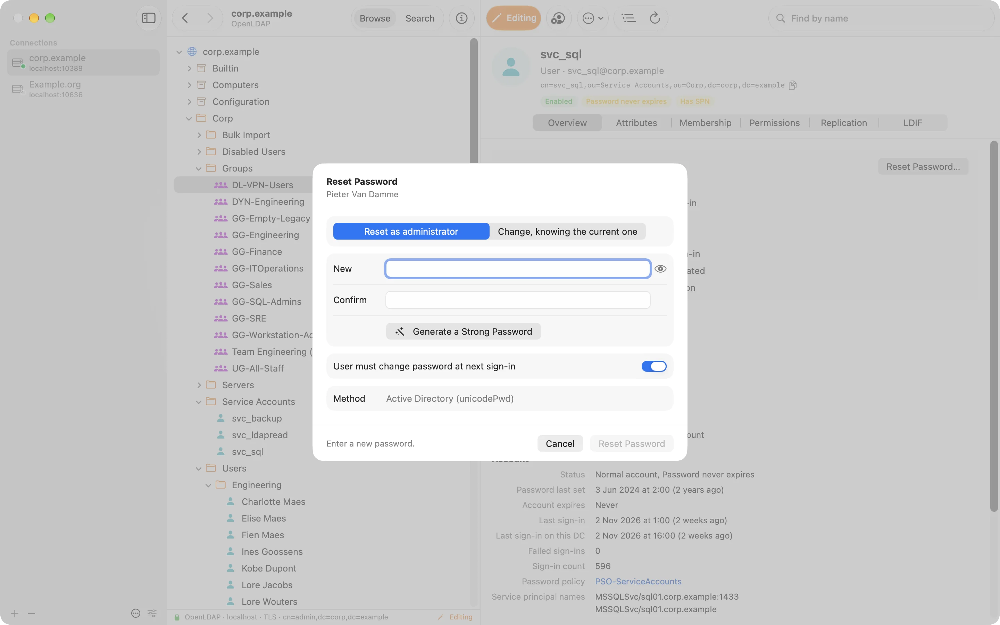
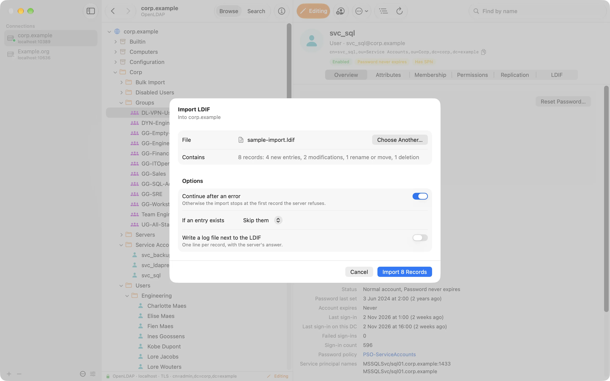
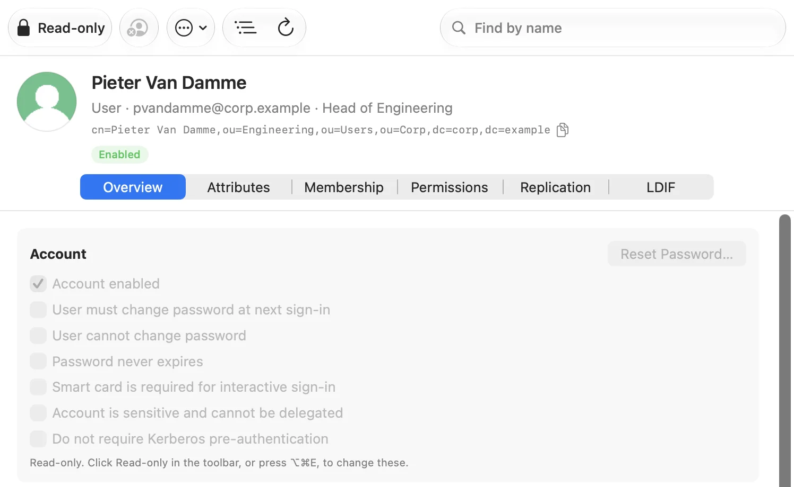

<p align="center">
  
</p>

<p align="center">
  <a href="https://apps.apple.com/app/forester-ldap-browser/id6830866952"></a>
  <a href="https://github.com/versaminds/forester/releases/latest"></a>
  <a href="https://forester.versaminds.live"></a>
</p>

# Forester

**The LDAP and Active Directory browser for Mac.**

A native macOS app to browse and administer LDAP directories and Active
Directory: users, groups, computers, OUs, policies, the schema and the server.
Free to use, made by [VersaMinds](https://www.versaminds.live), the company
behind Stackbridge.

- **Safe on production.** Every connection is read-only until you allow
  changes (the Read-only button, ⌥⌘E, or the connection's settings), and
  Edit › Undo takes changes back.
- **Active Directory in words.** Account flags, password policies, FSMO roles,
  replication metadata and permissions decoded, not shown as numbers and
  binary.
- **Fast with big directories.** Trees load a level at a time, searches page
  past server limits, and groups with thousands of members stay quick.
- **Native, with nothing else inside.** Swift on Apple's own frameworks: its
  own LDAP client, no third-party code, and Kerberos with the ticket your Mac
  already has.
- **Try it without a directory.** Help › Try a Sample Directory opens a
  public, read-only test directory.

## Install

- **Mac App Store:** [Forester: LDAP Browser](https://apps.apple.com/app/forester-ldap-browser/id6830866952),
  updated by the App Store.
- **Download:** the signed, notarized `Forester.dmg` from the
  [latest release](https://github.com/versaminds/forester/releases/latest); it
  updates itself.
- **Homebrew:** trust VersaMinds' tap once, then install the cask:

```bash
brew trust versaminds/tap
```

```bash
brew install --cask versaminds/tap/forester
```

Requires macOS 14 or later. If Forester saves you time, you can
[buy me a coffee](https://buymeacoffee.com/lennertmertens).

## Screenshots

<table>
  <tr>
    <td width="50%"><picture><source media="(prefers-color-scheme: dark)" srcset="site/img/search-dark-1600.webp"></picture><br><sub><b>Search</b> with any LDAP filter, a condition builder or 32 presets.</sub></td>
    <td width="50%"><picture><source media="(prefers-color-scheme: dark)" srcset="site/img/password-dark.webp"></picture><br><sub><b>Accounts:</b> reset passwords, unlock, enable and disable.</sub></td>
  </tr>
  <tr>
    <td width="50%"><picture><source media="(prefers-color-scheme: dark)" srcset="site/img/import-dark.webp"></picture><br><sub><b>LDIF import</b> says what a file will do before it runs.</sub></td>
    <td width="50%"><picture><source media="(prefers-color-scheme: dark)" srcset="site/img/read-only-dark.webp"></picture><br><sub><b>Read-only</b> until you allow changes, on every connection.</sub></td>
  </tr>
</table>

## Connecting to Active Directory

- **Host**: a domain controller, e.g. `dc01.corp.example`, or the domain name itself.
- **Security**: StartTLS on 389 or LDAPS on 636 (3269 for the global catalog).
  AD refuses password resets without encryption, and password binds too when
  the domain requires LDAP signing.
- **User**: `user@corp.example`, `CORP\user` or a full DN.
- **Certificates**: if your organisation's root CA is in Keychain Access, it just
  works. Otherwise the app shows the certificate chain and its SHA-256
  fingerprint: **Trust Once** for this session, or **Always Trust** to pin it to
  the connection (forget it again in the connection's settings).
- Bind failures are explained in words: AD's `data 52e`, `775`, `532` and the
  like become "wrong password", "locked out", "password expired".

Passwords are kept in the login keychain while "Remember the password in the
keychain" is on (the default), and in memory only otherwise. A saved password
is tied to the server, port, security, user and certificate checking it was
saved with: change any of them, or import a connection file that does, and
Forester asks for the password again instead of sending it somewhere new.

## What it does

**Browse.** A native outline view, loaded a level at a time and paged, so a
large OU opens without being read all at once. Object-class icons, disabled accounts dimmed,
"show containers only", Option-click to expand everything below, drag an entry
onto a container to move it.

**Inspect.** An overview that decodes what AD stores in binary or as numbers
(SIDs, GUIDs, FILETIME timestamps, `userAccountControl`, `groupType`, policy
intervals), with badges for disabled, locked out, password never expires,
unconstrained delegation, Kerberoastable and privileged accounts. A full
attribute table (multi-valued attributes collapse), raw and decoded views, hex
dumps, photos, certificates, and the entry as LDIF.

**Edit** (with editing on):

- Attribute values, live: a type-aware editor chosen from the server's schema
  (text, numbers, true/false, DNs with a directory picker, dates, AD account
  expiry, files and photos), checkboxes for `userAccountControl` and
  `groupType`, and an "add attribute" picker of what the entry's classes allow.
  Multi-valued changes are sent as additions and deletions, so adding one member
  to a large group does not rewrite it.
- New entries from templates (AD user with password, group, computer, contact;
  OU; inetOrgPerson, POSIX account and group; groupOfNames) or from any classes
  in the schema, with the schema's required attributes asked for. **Duplicate**
  copies an entry's settings and, optionally, its group memberships.
- Rename and move (ModifyDN), delete, and delete a whole subtree (AD's tree
  delete, or deepest-first elsewhere), with confirmation.
- **Undo.** Edit › Undo (⌘Z) and Redo take changes back, and Change History
  lists every change made in the window, with Undo for each and the reason for
  those that cannot be undone (deletions, passwords). An attribute change
  someone else changed again since is undone only when you say so, and in a
  list only the values the change added or removed are touched.

**Accounts.** Enable and disable (AD `userAccountControl`, 389DS
`nsAccountLock`, eDirectory `loginDisabled`, OpenLDAP password policy), unlock,
reset or change passwords (AD `unicodePwd`, RFC 3062, or `userPassword`), and
AD's "must change at next sign-in", "cannot change password" (the deny ACEs in
the account's security descriptor, as Active Directory Users and Computers
writes them), "password never expires", smart card and delegation options.

**Active Directory tools.** Domain information: NetBIOS name, SID, functional
levels, FSMO role holders, domain controllers and sites, trusts, Recycle Bin,
tombstone lifetime, the default password policy and fine-grained password
policies (PSOs) with who they apply to. Account status across every DC (bad
password counts and last sign-in are per DC). Per-attribute replication
metadata, and when each group member was added. **Permissions** in words: the
owner and every access rule (who, what, on which objects, inherited or set
here, with extended rights, property sets and attributes named from the
schema), and what your own account may do there. **Forests:** search every
domain through the global catalog, list the forest's domains and open any of
them. Nested membership in one query
(`LDAP_MATCHING_RULE_IN_CHAIN`), primary groups, and groups past 1,500 members
read in full.

**Search.** Any RFC 4515 filter, checked as you type, with attribute and
object-class names completed from the schema; a condition builder for those who
would rather not type filters; 32 presets (disabled users, stale computers,
Kerberoastable accounts, empty groups…); AD's ambiguous name resolution in the
toolbar search. Results page past the server's limits. **Whole forest** searches
every domain through the global catalog.

**Import and export.** LDIF import of entries and change records (add, modify,
rename, delete) with continue-on-error, "skip or update existing entries",
progress, a per-record log and an optional log file. LDIF export of an entry,
its children or a whole subtree, and CSV or LDIF export of search results.

**Server.** Server information from the root DSE (controls and extensions by
name), a monitor for OpenLDAP's `cn=Monitor` and 389 Directory Server's
`cn=monitor` and replication agreements, and a schema browser.

**Connections.** No directory yet? **Try a Sample Directory** (in the empty
window, or the Help menu) opens a public, read-only test directory that Forum
Systems runs, without signing in. Sign in with a name and password (a simple
bind, or **SCRAM-SHA-256**, which proves the password without sending it and
binds the TLS channel when the server can check that), anonymously, with a
**certificate** from the keychain (SASL EXTERNAL: the TLS client certificate
is the sign-in), or with **Kerberos**: the ticket the Mac already has (Ticket
Viewer, kinit, single sign-on), so no password is typed or kept. Kerberos goes
over StartTLS or LDAPS with the TLS channel bound into the exchange, or over
plain LDAP with Kerberos encrypting every message itself; a server that will
not encrypt is refused, never used unprotected. Saved with keychain passwords, imported and exported as
`.forester` files (passwords never included), and optionally kept in
iCloud Drive so they appear on your other Macs. Connections saved
by the app under its earlier name, LDAP Explorer, are picked up on first launch;
their passwords are asked for once.

**Updates and reports.** The Mac App Store version is updated by the App
Store. The download updates itself through Sparkle: releases signed by
VersaMinds, checked when you choose Forester › Check for Updates, or daily if
you say yes when it asks. Help › Copy Diagnostics copies what a problem report
needs, without host names, user names or passwords.

Keyboard: ⌘1 Browse, ⌘2 Search, ⌘[ / ⌘] back and forward, ⌘L show in tree,
⇧⌘G go to a DN, ⇧⌘C copy the DN, ⌘R refresh, ⌥⌘E allow or stop changes,
⌃⌘N new entry, ⌘D duplicate, ⇧⌘R rename, ⇧⌘M move, ⇧⌘E enable or disable,
⇧⌘P reset password, ⇧⌘I domain information, ⌃⌘M server monitor, ⌥⌘S schema,
⇧⌘O import LDIF.

## Compared with Arbor

[Arbor](https://arbor-ldap.app/) is a commercial macOS LDAP browser. Forester
covers its Active Directory, OpenLDAP and 389 Directory Server features, with
these differences:

- **eDirectory**: detected, and accounts are enabled, disabled and given
  passwords the eDirectory way, but there is no ACL/trustee editor, effective
  rights calculator, DirXML command submission or security-equivalence sync.
  Those need an eDirectory server to build against.
- **iCloud sync** works through iCloud Drive (Settings › Keep connections in
  iCloud Drive) rather than CloudKit. Passwords stay in each Mac's own keychain
  and are not synced.
- **Server statistics on eDirectory** are not read.

## Not yet

- Browsing another domain's tree from the same window: each domain opens as a
  connection of its own.
- Editing permissions (security descriptors) beyond "user cannot change
  password"; they are shown, not edited.

## Testing

[TESTING.md](TESTING.md) walks through it step by step. In short:

```bash
swift test
```

runs the unit tests. For everything else, start the local test directory, an
Active Directory-shaped OpenLDAP server built from the `slapd` macOS ships
(needs Python 3.11+, `brew install python`), which you may also change freely:

```bash
TestDirectory/start.sh
```

then run the integration tests against it:

```bash
FORESTER_TEST_SERVER=1 swift test
```

and point the app at `localhost`, port 10389, StartTLS, bound as
`CN=admin,DC=corp,DC=example` with password `secret`. TESTING.md lists what to
look at and what each screen should show. `TestDirectory/stop.sh` stops the
server; starting it again restores every entry.

`TestDirectory/start-ad.sh` starts a real Active Directory domain controller
(Samba, in a Podman container) with the same directory, and the app runs every
change it makes to AD against it; TESTING.md step 6. `TestDirectory/start-sasl.sh`
starts OpenLDAP with its own TLS and SASL in another container, for the
certificate and SCRAM sign-ins; TESTING.md step 3.

A debug build can also drive itself: through every screen, every sheet in light
and dark mode, and a session of real clicks and typing that checks each change
on the server. TESTING.md step 5 has the command, and `scripts/test-all.sh`
runs everything but the AD checks in one go, as GitHub Actions does on every
push. Releases are made every month by GitHub Actions, up to App Review:
docs/DISTRIBUTION.md, step 5.

## Development

### Build and run

Requires macOS 14 or later and Xcode. The Swift toolchain alone builds and
runs it, but the universal (Apple silicon and Intel) release build needs Xcode.

```bash
scripts/build-app.sh
```

```bash
open "build/Forester.app"
```

`scripts/build-app.sh universal` builds for Apple silicon and Intel. Copy the
app to `/Applications` if you like.

The script signs the app with a "Developer ID Application" or "Apple
Development" certificate from your keychain if there is one (or the one named
in `FORESTER_SIGN_IDENTITY`), and otherwise ad hoc, which is enough to run it on
the Mac that built it. An app signed ad hoc is a different app to the keychain
after every build, so macOS asks for your Mac's password, twice, before a new
build may use a saved connection password; choose **Always Allow** both times.
Signed with a certificate, it keeps that access from one build to the next.

### Debug builds and releases

```bash
swift run Forester
```

runs a debug build. `scripts/build-app.sh` makes the app bundle, and
`scripts/make-release.sh` the disk image people download (signed and notarized
when a Developer ID certificate is present). [docs/DISTRIBUTION.md](docs/DISTRIBUTION.md)
covers releasing: the download, Homebrew, the website and the Mac App Store.

### Layout

```
Sources/LDAPKit/        the LDAP client
  BER.swift             encoding and decoding
  LDAPFilter.swift      RFC 4515 filters
  LDAPMessage.swift     requests, responses, result codes, paged-results control
  LDAPWrite.swift       add, modify, delete, ModifyDN, password modify, tree delete
  LDAPTransport.swift   TCP + TLS (URLSessionStreamTask, so StartTLS can upgrade
                        a live connection) and certificate pinning
  LDAPConnection.swift  the connection actor: pipelined requests, paging,
                        ranged attributes, timeouts, cancellation
  Schema.swift          RFC 4512 schema: attribute types, classes, syntaxes
  LDIF.swift, LDIFParser.swift   LDIF out and in, change records included
  SecurityDescriptor.swift       Windows security descriptors (cannot change password)
  AccessRules.swift     access rules in words, and what an account may do
  Kerberos.swift        Kerberos sign-in: the TLS channel binding, or Kerberos
                        encryption of every message without TLS
  SASL.swift            certificate (EXTERNAL) and SCRAM-SHA-256 sign-in
  ADValues.swift, ADMetadata.swift, AttributeFormatter.swift, DN.swift,
  LDAPError.swift, ServerInfo.swift
Sources/Forester/       the app (SwiftUI, with an NSOutlineView for the tree)
  Model/                connections, the session, tree, search, change history
  Views/                the window: tree, inspector, search, permissions
  Views/Editing/        attribute editor, new entry, rename/move, delete, accounts
  Views/Tools/          LDIF import, AD tools, server monitor, schema browser
  Support/              About, updates, export, and the self-driving checks
Tests/LDAPKitTests/     unit tests and live-server integration tests
TestDirectory/          the local test server, the Samba domain controller, OpenLDAP
                        with SASL, and a sample LDIF
demo-server/            a directory of our own for App Review, should it ask for one
scripts/                app bundle, disk image, App Store package, icon, website images, checks
site/                   the website, forester.versaminds.live (Cloudflare Pages, wrangler.toml)
docs/                   releasing (DISTRIBUTION.md), the App Store (APP-STORE.md),
                        a first week with a real team (FIELD-TEST.md)
.github/workflows/      tests, the weekly check, releases, the website
```

## Licence

Forester is free to use, and its source is public so you can read every line
of what you run against your directory. It is licensed under the
[PolyForm Shield License 1.0.0](LICENSE): you may use, study, change and build
it for any purpose, at home or at work, except to offer a product that competes
with Forester, whether you charge for it or not. It comes with no warranty.

Forester, VersaMinds and Forester's icon are trademarks of VersaMinds BV; the
licence grants no right to use them ([TRADEMARKS.md](TRADEMARKS.md)).

Copyright © 2026 [VersaMinds](https://www.versaminds.live).
